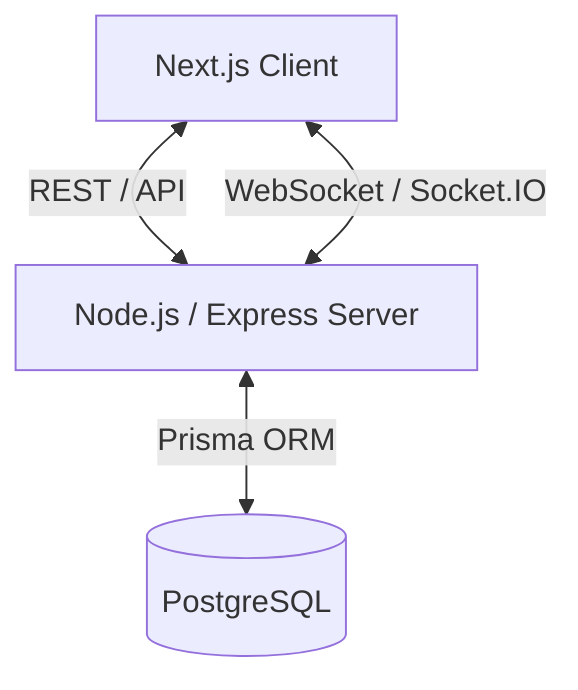

# THE WEB-VERSE (SpiderChat) - System Design & Architecture

## 1. Executive Summary
SpiderChat (The Web-Verse) is a highly scalable, real-time web application designed around the visual aesthetics of the "Spider-Man: Into the Spider-Verse" movies. The system provides real-time communication capabilities, ranging from ephemeral, anonymous chat rooms to persistent, authenticated 1-on-1 direct messaging (DMs) with friend management and global online presence tracking.

## 2. High-Level Architecture
The application follows a client-server architecture with real-time bidirectional communication.

- **Client:** Next.js (App Router, v15+) application, served independently. It acts as the presentation layer and state manager for the UI.
- **Server:** Node.js / Express backend handling REST API requests and Socket.IO for real-time events.
- **Database:** PostgreSQL database managed via Prisma ORM for data persistence (users, messages, friendships).

### Architecture Diagram (Conceptual)

## 3. Frontend Design System

The UI/UX is deeply thematic, employing comic-book aesthetics, halftone patterns, glitch effects, and bold typography.

### 3.1. Tech Stack
- **Framework:** Next.js 15+ (App Router)
- **Language:** TypeScript
- **Styling:** Tailwind CSS (v4) + Custom CSS Variables (`globals.css`)
- **Animation:** Framer Motion
- **Icons:** Lucide React

### 3.2. Aesthetic Principles & Tokens
Defined primarily in `client/src/app/globals.css`.
- **Colors:**
  - Spider Red: Primary action color.
  - Spider Blue: Secondary / background accent.
  - Spider Black/Dark: Deep background tones for the dark mode experience.
  - Spider White: High contrast text and borders.
- **Typography:**
  - Natively loaded via `<link>` tags (Bangers, Bebas Neue, Fredoka, Permanent Marker) to prevent Next.js font optimization blocking.
- **Visual Effects:**
  - **Halftone Backgrounds:** Dotted patterns simulating comic book paper.
  - **Shadows:** Heavy, solid drop shadows (`--shadow-comic`) on buttons and cards.
  - **Glitch:** RGB split animations via Framer Motion (`GlitchText.tsx`).

### 3.3. Key Components
- `LoadingAnimation.tsx`: Custom circular crop of a 200% zoomed Spider-Verse loading GIF.
- `AuthProvider.tsx`: Wraps the application to manage the user's session context asynchronously.
- `AnnouncementBanner.tsx`: Persistent top-level notification bar.
- `HangingWebs.tsx`: Thematic decorative elements scattered across the UI.

## 4. Backend & Real-Time Architecture

### 4.1. Server Stack
- **Runtime:** Node.js
- **Framework:** Express.js
- **Real-Time:** Socket.IO
- **Database ORM:** Prisma
- **Auth:** JWT (JSON Web Tokens) stored in HttpOnly cookies.

### 4.2. API Structure (REST)
The backend exposes RESTful endpoints for CRUD operations that don't require real-time capabilities.
- `/api/auth/*`: Registration, Login, Session Check (`/me`).
- `/api/users/*`: Profile management, searching users.
- `/api/friends/*`: Managing friend requests (send, accept, decline).
- `/api/messages/*`: Fetching paginated message history for DMs.

### 4.3. Socket.IO Event System
Socket.IO handles all real-time communication. The client connects via `socket.ts` and listens globally and locally.

**Global Events (Dashboard Level):**
- `spiderchat_live_users_update`: Broadcasts when friends come online/offline.
- `spiderchat_new_notification`: Alerts for new friend requests or system messages.
- `spiderchat_new_message`: Global alert for messages received outside the active chat view.

**Room Events (Chat Level):**
- `join_room`: Client requests to join a specific conversation ID.
- `receive_message`: Incoming message payload.
- `display_typing`: User typing state indicator.
- `user_list`: Updates the active participants in an anonymous room.

## 5. Database Schema (Prisma / PostgreSQL)

The core data models managing the persistent state of the application.

### 5.1. Models (High-Level overview)
- **User:**
  - Fields: `id`, `username`, `email`, `passwordHash`, `avatarUrl`, `bio`, `status` (online/offline).
  - Relations: Friends, FriendRequests, Messages sent.
- **FriendRequest:**
  - Fields: `id`, `senderId`, `receiverId`, `status` (PENDING, ACCEPTED, DECLINED), `createdAt`.
- **Conversation:**
  - Fields: `id`, `lastMessage`, `lastMessageAt`, `createdAt`, `updatedAt`.
  - Relations: Participants (Users), Messages (`DirectMessage`).
- **DirectMessage:**
  - Fields: `id`, `content`, `senderId`, `conversationId`, `createdAt`, `status`, `replyTo`, `reactions`, `deleted`, `attachments`.
  - Notes: Used exclusively for 1-on-1 direct messages. Public room messages are ephemeral (in-memory relay only) and never persisted to PostgreSQL.

## 6. Authentication & Security Flow

### 6.1. Authentication
1. **Login/Signup:** Client sends credentials to REST API.
2. **Token Issuance:** Server validates and signs a JWT.
3. **Storage:** JWT is set as an `HttpOnly`, `Secure` cookie to prevent XSS attacks.
4. **Session Hydration:** On reload, `<AuthProvider>` fetches `/api/auth/me`. If valid, hydrates state; if invalid, redirects to login or shows "SESSION TERMINATED".

### 6.2. Socket Authentication
When connecting via Socket.IO, the client passes the JWT or the server reads the cookie to authenticate the socket connection, preventing unauthorized room joining or message spoofing.

### 6.3. Guest Flow
Users can bypass authentication entirely by creating an anonymous room. A temporary alias is generated, and a random room code (e.g., UUID) is used for the socket connection. Data in these rooms is transient and not persisted to PostgreSQL.

## 7. Known System Constraints & Optimizations
- **Font Loading:** CSP and direct HTML `<link>` tags are used instead of `next/font/google` due to local network strictness.
- **State Management:** Uses standard DOM `CustomEvent` dispatched from socket listeners to update disparate React components without heavy global state libraries (like Redux).
- **Next.js Caching:** The `.next` directory cache can become corrupted in v15+; clearing it is the standard remediation for `PageNotFoundError`.
